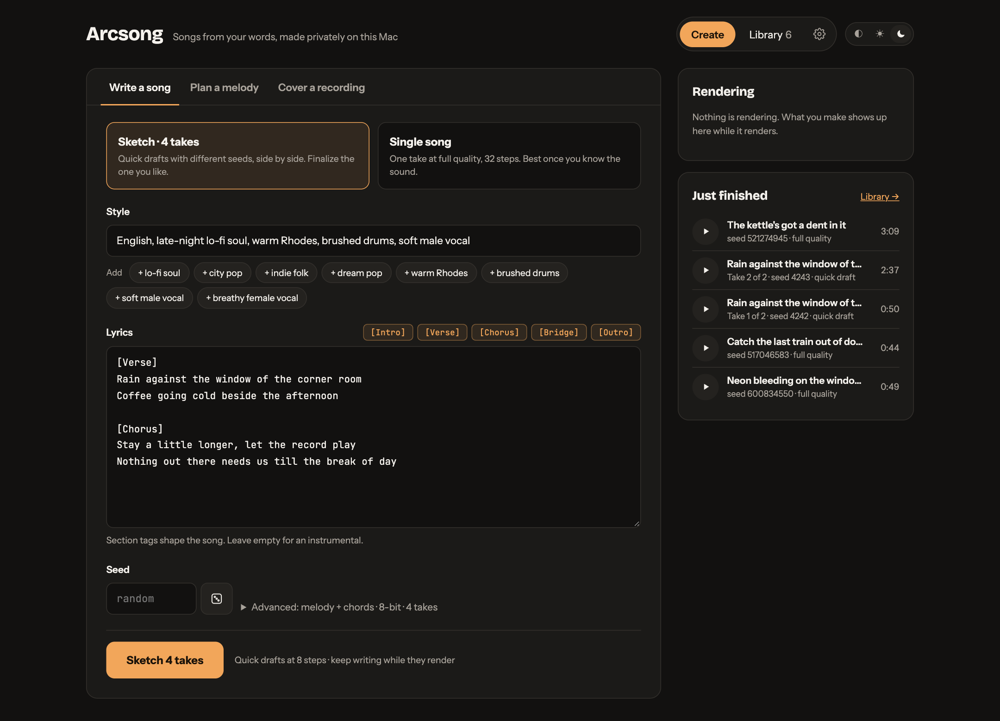
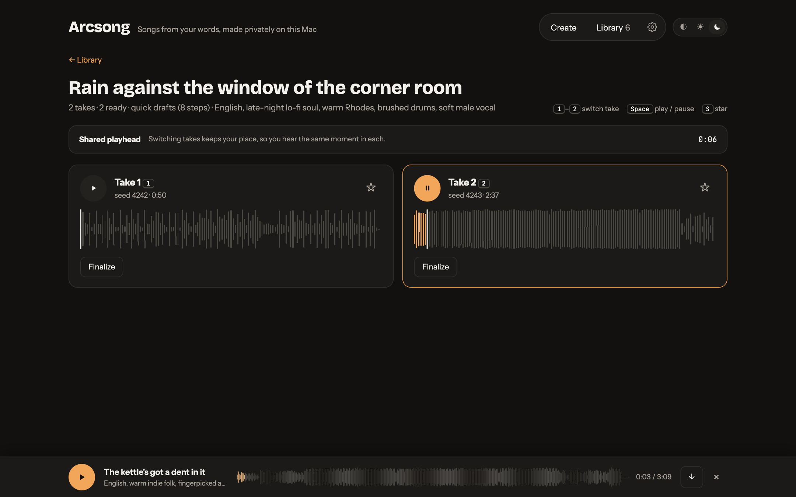
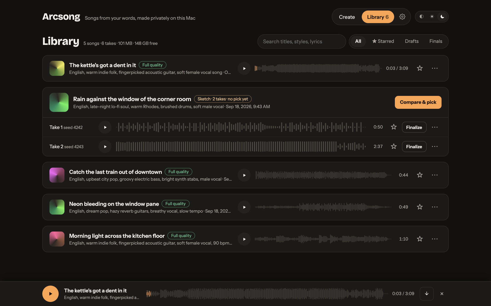
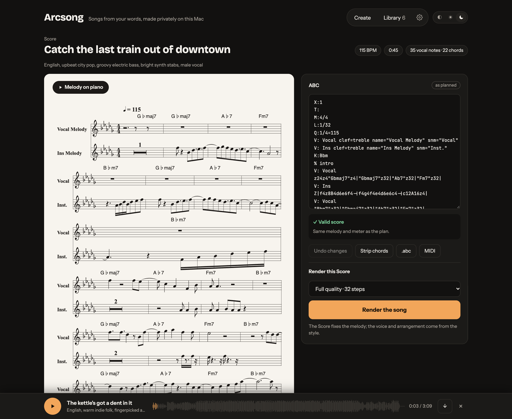
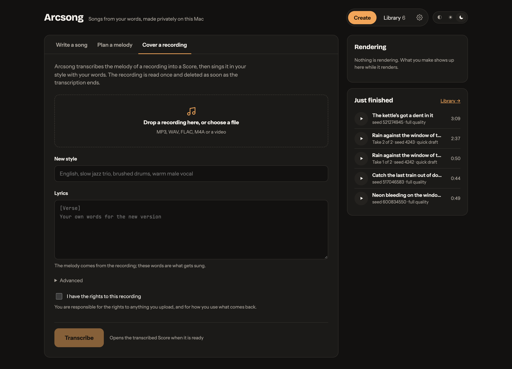
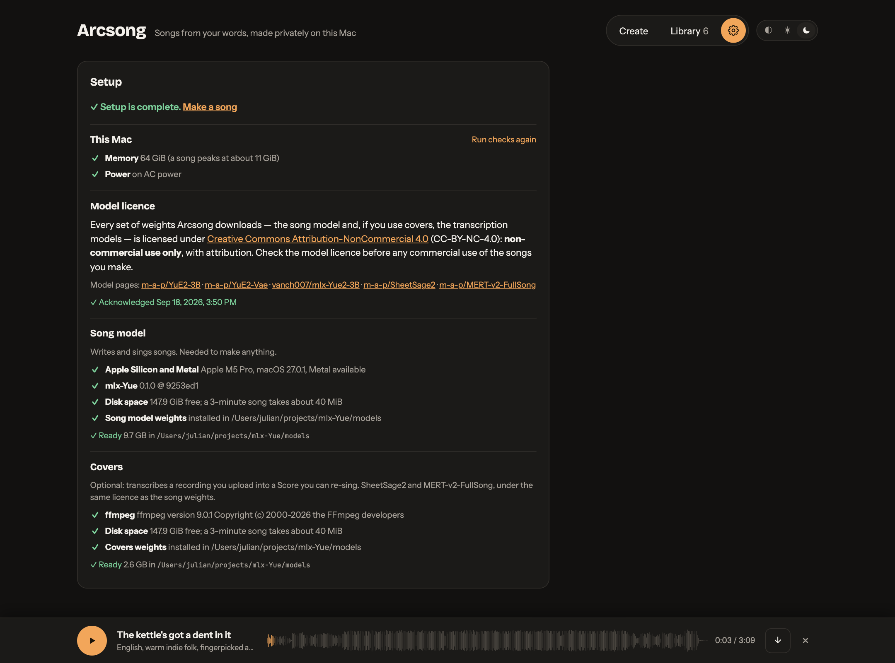

# Arcsong

Write a style and some lyrics, get a whole song — vocals and accompaniment — generated on your
own Mac. Arcsong is a local web app around the [YuE2](https://huggingface.co/m-a-p/YuE2-3B)
music model, running through the [mlx-Yue](https://github.com/vanch007/mlx-Yue) port on Apple
Silicon. Nothing is sent anywhere: the model, the weights and your songs stay on the machine.

> **Status: v0.2.0, early.** Apple Silicon only. Rendering on your own cloud GPU (Modal, RunPod)
> is being explored for Windows, Linux and smaller Macs.

## Hear it first

Three songs made with Arcsong, nothing edited — style and lyrics in, these came out. Each link
downloads a 45-second excerpt of the full take (GitHub won't play them in the page):

| | Style given to the model |
|---|---|
| [indie-folk.mp3](docs/media/samples/indie-folk.mp3) | *English, warm indie folk, fingerpicked acoustic guitar, soft female vocal, 90 bpm* |
| [dream-pop.mp3](docs/media/samples/dream-pop.mp3) | *English, dream pop, hazy reverb guitars, breathy vocal, slow tempo* |
| [city-pop.mp3](docs/media/samples/city-pop.mp3) | *English, upbeat city pop, groovy electric bass, bright synth stabs, male vocal* |

Each took two to four minutes to render on an M5 Pro, at 32 synthesis steps.

## What it does

**Write a song** from a style and lyrics. Click style suggestions and section tags (`[Verse]`,
`[Chorus]`) in, sketch a few quick takes or make one at full quality, and watch each stage render
in the column beside the form — you can keep writing meanwhile.



**Compare takes.** A sketch's takes play against one shared playhead, so switching take keeps
your place in the song. Keys: `1`–`8` switch take, `Space` plays or pauses, `S` stars. **Finalize**
turns the quick 8-step draft you starred into a full 32-step render with the same music.



**Keep what you make.** Songs get a title (their first sung line — rename them), artwork from
their seed, and a place in the Library, where a sketch's takes and Finals stay together. One
player follows you across the app, with waveforms to seek in and your Mac's media keys. FLAC and
WAV downloads are named after the song.



**Read and edit the Score.** The model plans a melody before it sings: see it as notation, play it
on a piano, edit the ABC beside it with live validation and a diff against the plan, and render a
song from your edit. Export ABC or MIDI.



**Covers** (optional): upload a recording, have it transcribed into a Score, and re-sing that
melody with your own style and lyrics. The recording is deleted as soon as the job ends.



Dark, light, or following macOS — the switch is in the header.

## Requirements

- macOS on Apple Silicon (M-series). The model peaks at about 11 GiB of unified memory, so
  24 GB or more is comfortable; below that, close other apps and local model servers.
- About 11 GB of disk for the song weights, downloaded from the Setup page on first run.
- For covers: [ffmpeg](https://ffmpeg.org) (`brew install ffmpeg`) and a further ~2.6 GiB of
  transcription weights.
- Songs render on battery too, more slowly, and a song is minutes of sustained GPU load.
  Start the app with `--require-ac` (or set `ARCSONG_REQUIRE_AC=1`) to only render when the
  Mac is plugged in.

## Install

```sh
uv tool install git+https://github.com/TensorAtelier/arcsong
arcsong serve
```

Then open <http://127.0.0.1:8840>. The first run opens the Setup page, which checks the machine,
shows the model licence, and downloads the weights with progress — you can close the page and
come back; the download resumes.



No Node is needed to run it: the web app ships prebuilt.

| | |
|---|---|
| Your songs and settings | `~/Library/Application Support/arcsong` (`--data DIR` or `$ARCSONG_DATA` to move them) |
| The weights | `<data>/models`, or `--mlx-models DIR` if you keep them elsewhere |
| The app itself | a private environment under `~/.local/share/uv/tools/arcsong`, with a `arcsong` command on your PATH |

```sh
uv tool upgrade arcsong      # pull a newer version
uv tool uninstall arcsong    # remove the app (your songs and weights stay)
```

Nothing is installed system-wide, and removing the tool leaves your data alone — delete the data
directory yourself if you want the songs and the 11 GB of weights gone too.

## Your first song

1. **Create → Write a song.** Name the song and type a style — a language, a genre, a few
   instruments and a voice, e.g. *English, late-night lo-fi soul, warm Rhodes, brushed drums, soft
   male vocal* — or roll the dice beside the box for a random one. Write lyrics with section tags (the `[Verse]`, `[Chorus]` …
   buttons insert them at the cursor). Leave the lyrics empty for an instrumental.
2. **Sketch 4 takes** (the second button at the bottom). Four quick drafts with different seeds, 8 synthesis steps each. They
   render one after another while you keep writing; the column on the right shows each stage.
3. **Compare & pick.** Play the takes against each other: `1`–`4` switch take at the same
   moment in the song, `Space` plays or pauses, `S` stars the one you like.
4. **Finalize** the starred take. It re-synthesizes the same music at full quality (32 steps);
   nothing about the melody or the voice changes.
5. **Library.** Every take, grouped by sketch, newest first. **Lyrics** on a row shows its lyrics
   and settings; the ⋯ menu renames a song, opens its Score, downloads FLAC or WAV (named after
   the title) and deletes it.

Already know the sound you want? Click **Make the song** instead: one take at full quality.

## When something goes wrong

- **"Arcsong was started with --require-ac, so songs wait for AC power."** Plug the Mac in, or
  start it without that flag (and without `ARCSONG_REQUIRE_AC`); renders are slower unplugged,
  and the memory a song needs is unchanged.
- **"macOS is short of memory."** A song needs about 11 GiB while it renders, and mlx-Yue stops
  rather than push the machine into swapping. Quit other local model servers — ComfyUI and
  LM Studio are the usual culprits — and start the job again.
- **"macOS moved memory to disk while the song rendered."** mlx-Yue stops a render when
  anything on the Mac swaps more than 64 MiB out, even with memory free — the count is
  system-wide. Close apps you aren't using and render again; the model reloads for the next song.
- **The Setup page says the weights are incomplete.** Press Download again: it resumes, and it
  cleans up the metadata files that would otherwise make mlx-Yue reject the directory.
- **Covers are greyed out.** They need ffmpeg (`brew install ffmpeg`) and their own weights;
  the Covers part of the Setup page checks both and says which is missing.
- **A song fails with "Another Lyra process owns the GPU".** Another Arcsong (or another
  mlx-Yue job) is already running; only one can hold the GPU at a time.

## Licences

The code is Apache-2.0 (see [`LICENSE`](LICENSE)).

**The model weights are not.** YuE2 and the transcription models are
[CC BY-NC 4.0](https://creativecommons.org/licenses/by-nc/4.0/) — non-commercial use only — and
Arcsong asks you to acknowledge that before it downloads anything. Check the model licence
before any commercial use of what you make, and if you upload a recording to cover, you are
responsible for having the rights to it. Third-party components are listed in
[`THIRD_PARTY_NOTICES.md`](THIRD_PARTY_NOTICES.md).

## Development

```sh
uv sync                     # Python side
cd web && npm install       # only if you are changing the page
uv run arcsong serve --engine fake   # no GPU, no weights: scripted stages and a test tone

uv run pytest -q            # the whole suite, on the fake engine — no GPU, no weights
uv run ruff check .
cd web && npm run typecheck && npm run build   # the build is committed
```

Slow tests that need real weights and the GPU are opt-in:
`ARCSONG_REAL_ENGINE=1 caffeinate -ims uv run pytest -q tests/test_real_engine.py`.

Architecture, conventions and the hard-won gotchas are in [`CLAUDE.md`](CLAUDE.md); the roadmap
and the reasoning behind the design are in [`PLAN.md`](PLAN.md).

## Credits

[YuE2](https://huggingface.co/m-a-p/YuE2-3B) and
[SheetSage2](https://huggingface.co/m-a-p/SheetSage2) by M-A-P; the Apple Silicon port
[mlx-Yue](https://github.com/vanch007/mlx-Yue) by vanch007. Arcsong is an independent front end
and is not affiliated with either.
