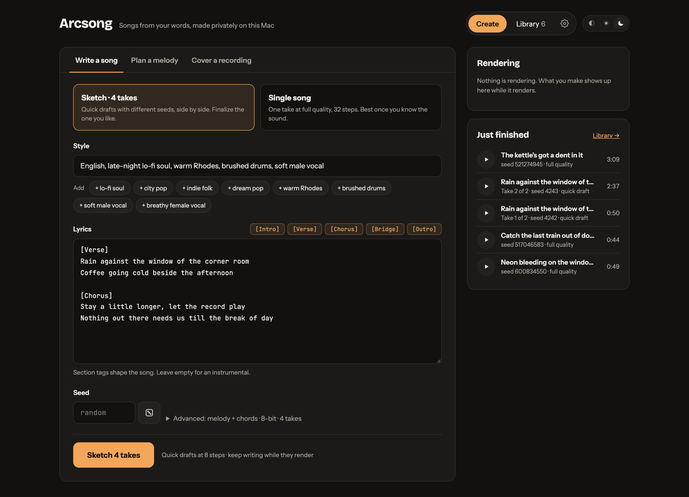
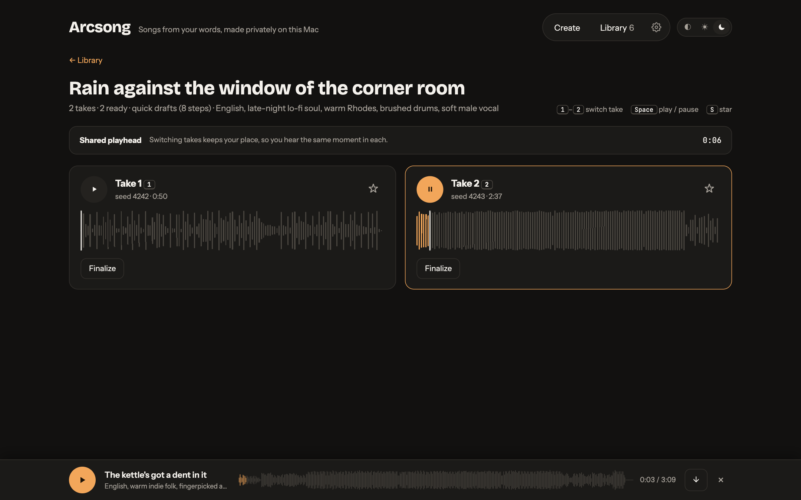
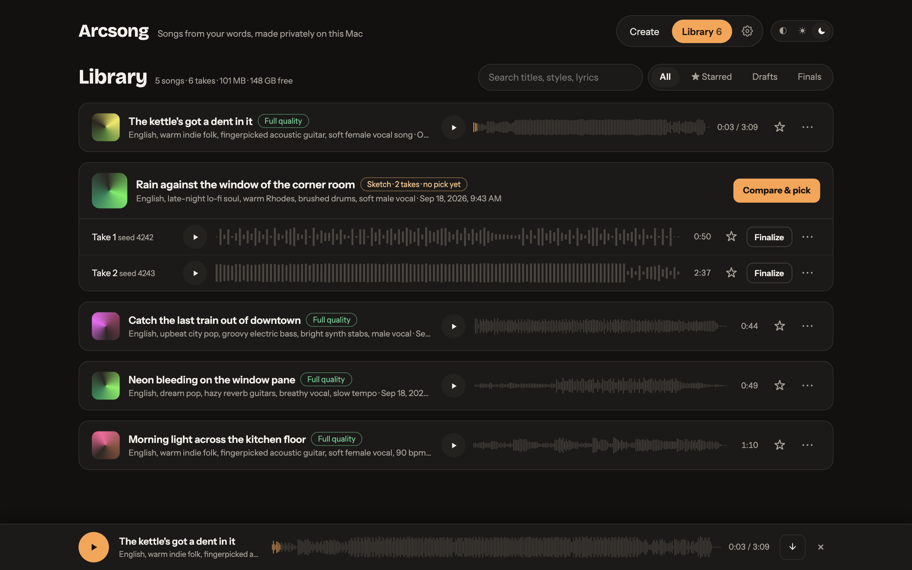
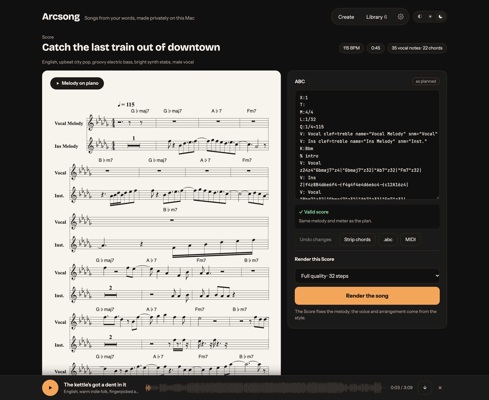
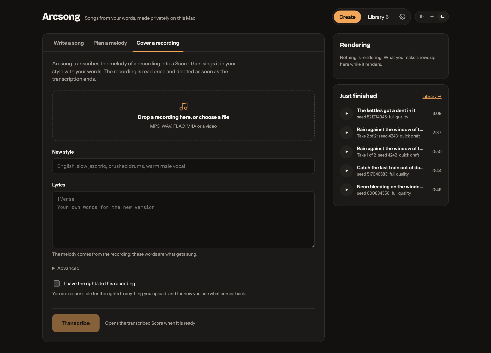
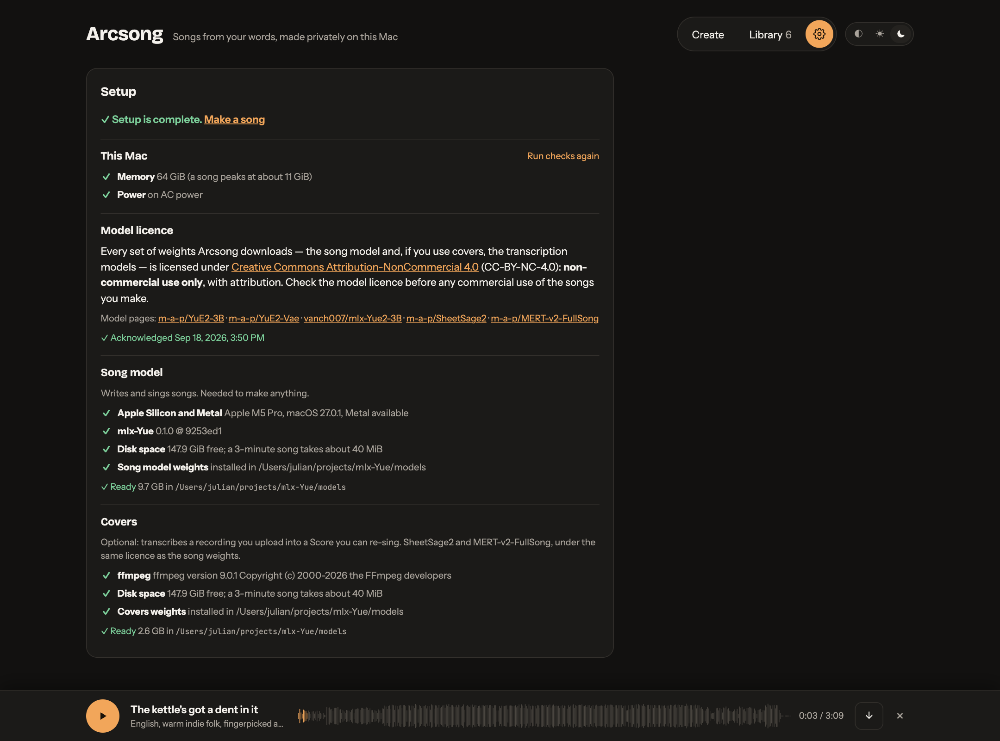

# Arcsong

Write a style and some lyrics, get a whole song — vocals and accompaniment — generated on your
own Mac. Arcsong is a local web app around the [YuE2](https://huggingface.co/m-a-p/YuE2-3B)
music model, running through the [mlx-Yue](https://github.com/vanch007/mlx-Yue) port on Apple
Silicon. Nothing is sent anywhere: the model, the weights and your songs stay on the machine.

> **Status: v0.6.0, early.** Renders on an Apple Silicon Mac, or on a cloud GPU in your own
> [Modal](#no-apple-silicon-render-on-modal) or [RunPod](#or-render-on-runpod) account (Windows,
> Linux, smaller Macs).

## Hear it first

Three songs made with Arcsong, nothing edited — style and lyrics in, these came out. Each link
downloads a 45-second excerpt of the full take (GitHub won't play them in the page):

| | Style given to the model |
|---|---|
| [indie-folk.mp3](docs/media/samples/indie-folk.mp3) | *English, warm indie folk, fingerpicked acoustic guitar, soft female vocal, 90 bpm* |
| [dream-pop.mp3](docs/media/samples/dream-pop.mp3) | *English, dream pop, hazy reverb guitars, breathy vocal, slow tempo* |
| [city-pop.mp3](docs/media/samples/city-pop.mp3) | *English, upbeat city pop, groovy electric bass, bright synth stabs, male vocal* |

Each took two to four minutes to render on an M5 Pro, at 32 synthesis steps.

## What it does

**Write a song** from a style and lyrics. Click style suggestions and section tags (`[Verse]`,
`[Chorus]`) in, sketch a few quick takes or make one at full quality, and watch each stage render
in the column beside the form — you can keep writing meanwhile.



**Compare takes.** A sketch's takes play against one shared playhead, so switching take keeps
your place in the song. Keys: `1`–`8` switch take, `Space` plays or pauses, `S` stars. **Finalize**
turns the quick 8-step draft you starred into a full 32-step render with the same music.



**Keep what you make.** Songs get a title (their first sung line — rename them), artwork from
their seed, and a place in the Library, where a sketch's takes and Finals stay together. One
player follows you across the app, with waveforms to seek in and your Mac's media keys. FLAC and
WAV downloads are named after the song.



**Read and edit the Score.** The model plans a melody before it sings: see it as notation, play it
on a piano, edit the ABC beside it with live validation and a diff against the plan, and render a
song from your edit. Export ABC or MIDI.



**Covers** (optional): upload a recording, have it transcribed into a Score, and re-sing that
melody with your own style and lyrics. The recording is deleted as soon as the job ends.



Dark, light, or following macOS — the switch is in the header.

## Requirements

- macOS on Apple Silicon (M-series). The model peaks at about 11 GiB of unified memory, so
  24 GB or more is comfortable; below that, close other apps and local model servers.
- About 11 GB of disk for the song weights, downloaded from the Setup page on first run.
- For covers: [ffmpeg](https://ffmpeg.org) (`brew install ffmpeg`) and a further ~2.6 GiB of
  transcription weights.
- Songs render on battery too, more slowly, and a song is minutes of sustained GPU load.
  Start the app with `--require-ac` (or set `ARCSONG_REQUIRE_AC=1`) to only render when the
  Mac is plugged in.

## Install

```sh
uv tool install git+https://github.com/TensorAtelier/arcsong
arcsong serve
```

Then open <http://127.0.0.1:8840>. The first run opens the Setup page, which checks the machine,
shows the model licence, and downloads the weights with progress — you can close the page and
come back; the download resumes.



No Node is needed to run it: the web app ships prebuilt.

| | |
|---|---|
| Your songs and settings | `~/Library/Application Support/arcsong` (`--data DIR` or `$ARCSONG_DATA` to move them) |
| The weights | `<data>/models`, or `--mlx-models DIR` if you keep them elsewhere |
| The app itself | a private environment under `~/.local/share/uv/tools/arcsong`, with a `arcsong` command on your PATH |

```sh
uv tool upgrade arcsong      # pull a newer version
uv tool uninstall arcsong    # remove the app (your songs and weights stay)
```

Nothing is installed system-wide, and removing the tool leaves your data alone — delete the data
directory yourself if you want the songs and the 11 GB of weights gone too.

## No Apple Silicon? Render on Modal

Arcsong can render on your own [Modal](https://modal.com) account instead of the Mac, so it also
runs on Windows, Linux and smaller Macs. The app still runs on your machine and keeps your songs
there; each song is made on a cloud GPU billed to your Modal account (an NVIDIA L4, or an A10G
or L40S when no L4 is free; the L40S costs more per second).

```sh
uv tool install --with-executables-from modal 'arcsong[modal] @ git+https://github.com/TensorAtelier/arcsong'
modal setup                     # Modal's own login, once; Arcsong never sees your token
arcsong serve --engine modal
```

On the Setup page, **Set up on Modal** deploys a small app called `arcsong` into your Modal
workspace and fetches the weights (about 8 GB) into a Modal Volume there, in the cloud. After
that, Create, Sketch, Compare, Finalize and the Score page work as on the Mac.

- **Cost and speed** (measured October–November 2026): a 3-minute song at full quality took
  about 200 s and $0.045 from a cold L4; a one-minute sketch take took under a minute on a warm
  GPU. The first job after a pause waits about three minutes while the GPU starts and the model
  loads, longer if GPUs are scarce. The GPU shuts down five minutes after the last job, and
  Modal bills by the second. Stopping Arcsong mid-song leaves that song running on Modal until
  it finishes; cancel it in the page instead.
- **Not on Modal yet:** covers (they need the Mac engine), and the 8-bit/bf16 choice (Modal
  renders bf16). A Draft made on the Mac can't be finalized on Modal, or the other way round.
- To remove it: `modal app stop arcsong` and `modal volume delete arcsong-yue2-weights`, then
  delete the `modal` folder in Arcsong's data directory so Setup offers to set it up again.

## Or render on RunPod

The same, on your own [RunPod](https://runpod.io) account: each song runs as a Serverless job on
a 24 GB GPU (an RTX 4090, L4, A5000 or 3090, whichever has stock), billed to your RunPod balance.

```sh
uv tool install --with-executables-from runpod 'arcsong[runpod] @ git+https://github.com/TensorAtelier/arcsong'
rp login                        # RunPod's own login, once (or export RUNPOD_API_KEY)
arcsong serve --engine runpod
```

On the Setup page, **Set up on RunPod** deploys a Serverless endpoint called `render` (app
`arcsong`) to your account, in about two minutes. Nothing is stored there: RunPod stages the
model weights on the GPU's host for each worker, so there is no volume to pay for.

- **Cost and speed** (measured November 2026): a sketch of two 2.6-minute takes, a Finalize, a
  planned melody and a cancelled song used about $0.05 of balance in all. The first job after a
  pause takes about three minutes before it starts (RunPod pulls its GPU image); a take on a warm
  worker took about a minute, a Finalize 25 s. The worker stops two minutes after the last job;
  nothing bills while it's stopped.
- **Your key on RunPod:** RunPod's SDK copies your API key into the endpoint's settings on your
  own account (it does that for every app it deploys). Arcsong itself stores no key.
- **Not on RunPod yet:** covers, and the 8-bit/bf16 choice (it renders bf16). A Draft made on the
  Mac can't be finalized on RunPod.
- To remove it: `rp flash app delete arcsong --yes`, then delete the `runpod` folder in Arcsong's
  data directory.

`--with-executables-from` puts the cloud's own command (`modal`, `rp`) on your PATH beside
`arcsong`; without it `uv tool install` exposes only `arcsong`.

## Your first song

1. **Create → Write a song.** Name the song and type a style — a language, a genre, a few
   instruments and a voice, e.g. *English, late-night lo-fi soul, warm Rhodes, brushed drums, soft
   male vocal* — or roll the dice beside the box for a random one. Write lyrics with section tags (the `[Verse]`, `[Chorus]` …
   buttons insert them at the cursor). Leave the lyrics empty for an instrumental.
2. **Sketch 4 takes** (the second button at the bottom). Four quick drafts with different seeds, 8 synthesis steps each. They
   render one after another while you keep writing; the column on the right shows each stage.
3. **Compare & pick.** Play the takes against each other: `1`–`4` switch take at the same
   moment in the song, `Space` plays or pauses, `S` stars the one you like.
4. **Finalize** the starred take. It re-synthesizes the same music at full quality (32 steps);
   nothing about the melody or the voice changes.
5. **Library.** Every take, grouped by sketch, newest first. **Lyrics** on a row shows its lyrics
   and settings; the ⋯ menu renames a song, opens its Score, downloads FLAC or WAV (named after
   the title) and deletes it.

Already know the sound you want? Click **Make the song** instead: one take at full quality.

## When something goes wrong

- **"Arcsong was started with --require-ac, so songs wait for AC power."** Plug the Mac in, or
  start it without that flag (and without `ARCSONG_REQUIRE_AC`); renders are slower unplugged,
  and the memory a song needs is unchanged.
- **"macOS is short of memory."** A song needs about 11 GiB while it renders, and mlx-Yue stops
  rather than push the machine into swapping. Quit other local model servers — ComfyUI and
  LM Studio are the usual culprits — and start the job again.
- **"macOS moved memory to disk while the song rendered."** mlx-Yue stops a render when
  anything on the Mac swaps more than 64 MiB out, even with memory free — the count is
  system-wide. Close apps you aren't using and render again; the model reloads for the next song.
- **The Setup page says the weights are incomplete.** Press Download again: it resumes, and it
  cleans up the metadata files that would otherwise make mlx-Yue reject the directory.
- **Covers are greyed out.** They need ffmpeg (`brew install ffmpeg`) and their own weights;
  the Covers part of the Setup page checks both and says which is missing.
- **A song fails with "Another Lyra process owns the GPU".** Another Arcsong (or another
  mlx-Yue job) is already running; only one can hold the GPU at a time.

## Licences

The code is Apache-2.0 (see [`LICENSE`](LICENSE)).

**The model weights are not.** YuE2 and the transcription models are
[CC BY-NC 4.0](https://creativecommons.org/licenses/by-nc/4.0/) — non-commercial use only — and
Arcsong asks you to acknowledge that before it downloads anything. Check the model licence
before any commercial use of what you make, and if you upload a recording to cover, you are
responsible for having the rights to it. Third-party components are listed in
[`THIRD_PARTY_NOTICES.md`](THIRD_PARTY_NOTICES.md).

## Development

```sh
uv sync                     # Python side
cd web && npm install       # only if you are changing the page
uv run arcsong serve --engine fake   # no GPU, no weights: scripted stages and a test tone

uv run pytest -q            # the whole suite, on the fake engine — no GPU, no weights
uv run ruff check .
cd web && npm run typecheck && npm run build   # the build is committed
```

Slow tests that need real weights and the GPU are opt-in:
`ARCSONG_REAL_ENGINE=1 caffeinate -ims uv run pytest -q tests/test_real_engine.py`.

Architecture, conventions and the hard-won gotchas are in [`CLAUDE.md`](CLAUDE.md); the roadmap
and the reasoning behind the design are in [`PLAN.md`](PLAN.md).

## Credits

[YuE2](https://huggingface.co/m-a-p/YuE2-3B) and
[SheetSage2](https://huggingface.co/m-a-p/SheetSage2) by M-A-P; the Apple Silicon port
[mlx-Yue](https://github.com/vanch007/mlx-Yue) by vanch007. Arcsong is an independent front end
and is not affiliated with either.
